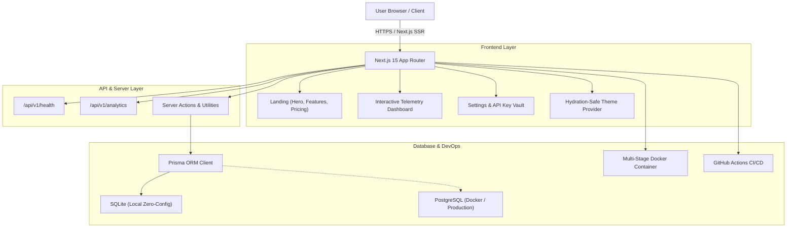

<div align="center">

# ⚡ Nexus — Enterprise Full-Stack SaaS Starter Kit

**Production-grade, highly modular boilerplate engineered for modern software founders, indie builders, and engineering teams.**

[](https://github.com)
[](https://nextjs.org/)
[](https://react.dev/)
[](https://www.typescriptlang.org/)
[](https://tailwindcss.com/)
[](https://www.prisma.io/)
[](LICENSE)

[Live Demo](#) · [Features](#-key-features) · [Quick Start](#-quick-start) · [Architecture](#-architecture) · [Contributing](CONTRIBUTING.md)

</div>

---

## 🚀 Overview

**Nexus** is an opinionated, production-ready Full-Stack SaaS boilerplate designed to eliminate boilerplate fatigue. Built around Next.js 15 App Router, React 19, and Tailwind CSS, it packs authentic database schemas, developer API key workflows, interactive analytics telemetry, automated GitHub Actions CI/CD, and multi-stage container deployment out of the box.

---

## 🏗️ Architecture



---

## ✨ Key Features

- ⚡ **Next.js 15 & React 19**: Modern App Router architecture with server components and streaming support.
- 🎨 **Tailwind CSS & Dark Mode**: Flawless, flicker-free dark and light mode toggle with custom design tokens.
- 📊 **Interactive Analytics Dashboard**: Live metrics for MRR, DAU/MAU, user activity feed, and monthly revenue visualizer.
- 🗄️ **Prisma ORM (Zero-Config)**: Type-safe SQLite default for zero-friction local development, switchable to PostgreSQL with one variable.
- 🔑 **API Key & Security Vault**: Developer API key generator, clipboard utilities, and 2FA policy toggles.
- 🧪 **Vitest & React Testing Library**: Pre-configured unit and component test suites with instant execution.
- 🐳 **Docker & Docker Compose**: Optimized multi-stage production Dockerfile and container orchestration.
- 🤖 **GitHub Actions CI/CD**: Automatic linting, typechecking, Vitest validation, and production build checks on every push and PR.
- 📜 **Full Community Governance**: Issue templates, PR templates, Code of Conduct, Security policy, and MIT license.

---

## 🗂️ Project Structure

```text
nexus-saas-template/
├── .github/
│   ├── workflows/
│   │   ├── ci.yml               # Automated Lint, Test & Build pipeline
│   │   └── codeql.yml           # CodeQL Security static analysis
│   ├── ISSUE_TEMPLATE/
│   │   ├── bug_report.yml       # Interactive bug report issue form
│   │   └── feature_request.yml  # Feature proposal template
│   └── PULL_REQUEST_TEMPLATE.md # Standard PR review checklist
├── app/
│   ├── api/v1/
│   │   ├── analytics/route.ts   # Platform analytics telemetry endpoint
│   │   └── health/route.ts      # Automated health check route
│   ├── dashboard/
│   │   ├── settings/page.tsx    # Organization settings & API keys
│   │   ├── layout.tsx           # Dashboard shell with sidebar
│   │   └── page.tsx             # Interactive metrics & activity overview
│   ├── globals.css              # Global tokens & theme utilities
│   ├── layout.tsx               # Root HTML wrapper with theme provider
│   └── page.tsx                 # Modern conversion-focused landing page
├── components/
│   ├── dashboard-sidebar.tsx    # Responsive side navigation
│   ├── features.tsx             # Capabilities breakdown grid
│   ├── footer.tsx               # Footer with live status indicator
│   ├── hero.tsx                 # High-impact hero section
│   ├── metric-card.tsx          # Stat card with delta trend badge
│   ├── navbar.tsx               # Navigation bar with dark mode switch
│   ├── pricing.tsx              # Annual/monthly tiered pricing table
│   └── theme-provider.tsx       # Dark & light theme context
├── lib/
│   ├── constants.ts             # Pricing plans, metrics & demo constants
│   ├── db.ts                    # Prisma Client singleton
│   └── utils.ts                 # Formatting, class merging, and key generation
├── prisma/
│   ├── schema.prisma            # Models: User, Organization, Subscription, AuditLog
│   └── seed.js                  # Database demo seeder
├── tests/
│   ├── setup.ts                 # Vitest DOM extensions setup
│   ├── utils.test.ts            # Unit tests for core utilities
│   └── metric-card.test.tsx     # React component test suite
├── Dockerfile                   # Multi-stage production container
├── docker-compose.yml           # App + PostgreSQL container setup
├── package.json                 # Project dependencies & npm scripts
├── tsconfig.json                # TypeScript strict configuration
└── vitest.config.ts             # Vitest test runner configuration
```

---

## 🚀 Quick Start

### 1. Prerequisites
- **Node.js**: v18.18+ or v20+ (tested on Node 20 & 24)
- **npm**: v9+ or v11+

### 2. Clone and Install

```bash
# Clone the repository
git clone https://github.com/your-username/nexus-saas-template.git
cd nexus-saas-template

# Install dependencies
npm install
```

### 3. Environment Configuration

```bash
# Copy example environment configuration
cp .env.example .env.local
```

### 4. Initialize Database

By default, Nexus uses SQLite for instant local development with zero external dependencies required:

```bash
# Synchronize Prisma schema with local database
npm run db:push

# (Optional) Populate with realistic demo data
npm run db:seed
```

### 5. Launch Development Server

```bash
npm run dev
```

Open [http://localhost:3000](http://localhost:3000) in your browser to view the application.

---

## 🧪 Testing & Code Quality

Run tests and static validation tools with:

```bash
# Run unit & component tests via Vitest
npm run test

# Run Vitest in interactive watch mode
npm run test:watch

# Run ESLint validation
npm run lint

# Build production bundle
npm run build
```

---

## 🐳 Running with Docker

Deploy locally with PostgreSQL using Docker Compose:

```bash
# Build and run containers
docker-compose up --build

# Run detached in background
docker-compose up -d
```

---

## 🤝 Contributing

Contributions make the open-source community an amazing place to learn, inspire, and create. Any contributions you make are **greatly appreciated**.

Please review our [Contributing Guidelines](CONTRIBUTING.md) and [Code of Conduct](CODE_OF_CONDUCT.md) before submitting a Pull Request.

---

## 📄 License

Distributed under the **MIT License**. See [`LICENSE`](LICENSE) for more information.

---

<div align="center">
  <sub>Built with ❤️ for founders, developers, and open source creators.</sub>
</div>
